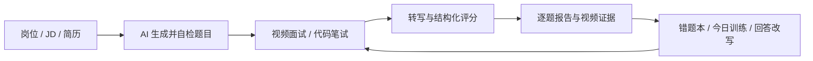

# Light-Interview

### 从岗位 JD 到真实开口回答的 AI 面试训练系统

把“我知道该怎么答”，练成“我真的答得出来”。

Light-Interview 是一个开源 AI 面试训练系统：输入目标岗位、JD 和简历，完成一次可录制、可回放、可评分、可重练的模拟面试。

它不只给你一段聊天式评价，而是把一次练习变成完整闭环：

- 录下真实回答，生成逐题转写和结构化反馈；
- 回到视频时间点查看回答证据；
- 对低分回答进行改写、重录和前后对比；
- 把薄弱题目放进错题本和每日训练计划；
- 用 Docker 隔离沙箱真实运行 Java、Python、C++、JavaScript、Go 代码题。

适合准备校招、社招、转岗和技术晋升面试的开发者。

> **在线体验：[http://5aicv.cn:8080](http://5aicv.cn:8080)**
>
> 无需安装即可打开。当前演示入口使用 HTTP；涉及麦克风和摄像头的录制功能需要在 HTTPS 环境运行。

[](https://github.com/xgwangdl/AI-Interview/actions/workflows/build.yml)
[](#工程质量)
[](#工程质量)
[](https://adoptium.net/)
[](https://spring.io/projects/spring-ai)
[](https://vuejs.org/)
[](LICENSE)

[在线体验](http://5aicv.cn:8080) · [快速开始](#快速开始) · [先看演示](#先看演示) · [训练闭环](#一套完整的训练闭环) · [核心能力](#核心能力) · [技术拆解](#为什么不是套壳-demo) · [使用手册](docs/USER-GUIDE.md) · [项目架构](docs/ARCHITECTURE.md) · [安全策略](SECURITY.md) · [English](docs/README.md)

<p align="center">
  
</p>

<p align="center">
  <sub>真人形象数字人面试官 · 语音播报 · 音量驱动嘴型 · 逐题录制 · 可回放复盘</sub>
</p>

## 先看演示

以下演示均使用当前版本重新录制（2026-10-18）：

| 演示 | 时长 | 内容 |
| --- | ---: | --- |
| [产品总览](docs/demo-tour.mp4) | 26 秒 | 登录、训练总览、练习配置、笔试与报告 |
| [模拟面试](docs/demo-interview.mp4) | 14 秒 | 设备检测、数字人提问与逐题录制 |
| [复盘报告](docs/demo-report.mp4) | 16 秒 | 评分、转写、回答改写与示范回答 |

如果这个项目让你觉得“我真的可以拿它练一次面试”，欢迎点一个 Star。Star 会帮助更多正在准备面试的人发现它，也会帮助项目继续完善真实求职场景。

## 一套完整的训练闭环



和多数“对话框式 AI 面试”相比，Light-Interview 更接近一条真正可重复使用的训练流水线：

| 你得到的不是 | 而是 |
| --- | --- |
| 一段无法验证的 AI 评价 | 可回到录像时间点的逐题证据 |
| 一个看似能判题的聊天窗口 | 禁网、限时、限内存的 Docker 判题沙箱 |
| 练完就散的一次性体验 | 目标、连续记录、错题本、周报和重练闭环 |
| 只适合演示的页面 | 有迁移、测试、CI、限流、额度和故障恢复的完整应用 |

## 核心能力

### 面试训练

- 界面支持简体中文、English、日本語；语言跟随账号保存在个人设置中，退出登录会清理本地语言状态。
- AI 根据目标岗位、JD 和简历生成题目，支持技术面、行为面、不同难度与面试官风格。
- 真人形象数字人播报问题，支持提问、聆听、录制、追问等状态；嘴型由音量驱动，不冒充音素级同步。
- 浏览器逐题录制，也可使用连续面试模式；每题可暂停、重录和回放。
- 追问会根据回答质量决定是否继续；同一道题最多两轮，避免机械式固定流程。
- 报告包含内容相关性、完整度、专业性、STAR、逻辑、语速、停顿和口头禅等维度。
- 转写可人工校正后单题重评；回答可 AI 改写、照着重录，并保留旧版本做前后对比。

### 笔试与上机

- Monaco 网页 IDE，支持 Java、Python、C++、JavaScript、Go。
- 五种题型：上机编程、SQL、编程填空、选择题、简答题。
- 代码在一次性 Docker 容器中运行：禁网、只读文件系统、限制 CPU / 内存 / 进程数与执行时间。
- AI 出题后先运行参考解生成预期输出；参考解跑不通的题不会发给用户。
- 隐藏用例只显示“第 N 个用例未通过”，既保留反馈也不直接泄露答案。

### 成长与留存

- 一个求职目标对应公司、岗位、JD、面试日期和每日 3 题计划。
- 低于 75 分的题进入错题本，可一键重练到过线。
- 周报汇总计划完成率、维度变化、最佳进步和下一周建议。
- 英语口语练习：场景对话、即时纠错、四项复盘；支持手打降级。
- 多角色学习小组：助教布置作业、查看完成看板；学员求助、匿名互评。
- 简历库支持上传解析、从零生成、按 JD 优化，并导出 Markdown / Word / PDF。

### 产品与工程细节

- 账号注册、个人资料、主题色、字号与减弱动效设置。
- AI 调用额度按账号计数，成本有上限；排队中的分析任务会顺延而不是直接失败。
- 录像默认保留 7 天，可随时删除；支持本地磁盘或 S3 兼容对象存储。
- 大文件分片上传与断点续传；分析与媒体接口均有归属校验。
- 三套主题：松绿、藏青、赭橙；桌面与手机布局均已适配。

## 快速开始

### 本机开发（打开 5173）

需要 Docker Desktop、Java 21、Maven、Node.js 和 Git。

```bash
git clone https://github.com/xgwangdl/AI-Interview.git
cd AI-Interview
cp .env.example .env

# 终端 1：基础设施
docker compose up -d postgres redis s3mock

# 终端 2：后端
mvn -B package -DskipTests
java -jar consumer/target/consumer-0.0.1-SNAPSHOT.jar

# 终端 3：前端
npm --prefix web ci
npm --prefix web run dev
```

Windows PowerShell 把 `cp` 换成：

```powershell
Copy-Item .env.example .env
```

后端和前端都启动后，打开：

<http://localhost:5173>

```text
演示账号：smoke / 123456
```

更完整的 Windows 本地启动、重启、停止和排错步骤见
[本地启动手顺](docs/LOCAL-STARTUP.md)。

### 完整 Docker（打开 8080）

如果不想分别启动 Java 和 Node：

```bash
docker compose --profile full up -d --build
```

完成后打开 <http://localhost:8080>。这个入口由 nginx 提供，和本机 Vite 的 `5173` 是两个不同端口。

在 `.env` 中至少设置：

```dotenv
AUTH_TOKEN_SECRET=换成一个仅本地使用的长字符串
Ali_API_KEY=你的百炼 API Key
```

没有 API Key 时，可先使用 `stub` 转写与评分体验完整界面：

```dotenv
Ali_API_KEY=local-placeholder
PRACTICE_ASR_PROVIDER=stub
PRACTICE_EVALUATION_PROVIDER=stub
```

### Docker 镜像

正式版本会把前后端镜像发布到 GitHub Packages。以 `v0.2.0-beta.1` 为例：

```bash
docker pull ghcr.io/xgwangdl/light-interview-backend:0.2.0-beta.1
docker pull ghcr.io/xgwangdl/light-interview-web:0.2.0-beta.1
```

镜像页面：[GitHub Packages](https://github.com/xgwangdl?tab=packages) · [版本发布](https://github.com/xgwangdl/AI-Interview/releases)

## 为什么不是套壳 Demo

### 题目先自检，再交给用户

编程题不是让模型“猜一个标准答案”。系统先生成题面和参考解，把参考解放进沙箱运行，用真实输出生成用例；只有参考解自己通过全部用例，题目才会被使用。

### 判题边界真的落到了容器参数

```text
--network none
--memory 256m --memory-swap 256m
--cpus 0.5 --pids-limit 64
--read-only --tmpfs /tmp:rw,size=64m
```

编译和运行分别限时，输出落盘后再读取，超时后强制清理容器。它不能替代生产级隔离集群，但已经明显超出“只检查代码文本”的演示级实现。

### 分析流水线可以恢复

<details>
<summary>展开技术细节</summary>

- 分析任务数据库持久化，进程重启后继续处理。
- 原子领取任务，多实例不会重复评分。
- 指数退避重试，超过上限进入死信队列。
- 卡死任务会被回收，供应商调用有超时。
- Prometheus 暴露队列长度、失败率、重试和死信指标。
- 上传支持分片、合并、断点查询和清理。

</details>

### 不是只做了前端

| 层 | 实现 |
| --- | --- |
| 后端 | Java 21 · Spring Boot 3.4 · Spring AI 1.1.8 · Spring AI Alibaba |
| 前端 | Vue 3.5 · Vite 6 · Element Plus · Pinia · Monaco Editor |
| 数据 | PostgreSQL 16 + pgvector · Redis 7 · Flyway |
| 媒体 | MediaRecorder · ffmpeg · Paraformer ASR · Sambert TTS |
| 执行 | Docker 隔离沙箱 · SQLite · 5 种编程语言 |
| 运维 | Actuator · Prometheus · 额度护栏 · 重试与死信队列 |

## 工程质量

- 后端 **312** 个测试通过，13 个依赖外部环境的测试按配置跳过；集成环境下仅 7 个跳过。
- 前端 **145** 个测试通过，生产构建通过。
- 浏览器认证冒烟使用系统 Chrome，可重复验证登录、注册、空值提示和路由保护。
- GitHub Actions 执行后端测试、前端测试、数据库/S3 集成测试和五语言 Docker 沙箱测试。
- 已完成真实 PostgreSQL、Redis、S3 兼容存储和真实模型供应商的链路验证。
- 当前已知边界：数字人口型是按音量驱动，不是音素级同步；L2 流式外语通道默认关闭。

完整验证记录见 [docs/STATUS.md](docs/STATUS.md)。

## 目录结构

```text
consumer/    Spring Boot 后端、AI 能力、判题沙箱、数据库迁移
common/      统一响应、异常、JWT 与共享工具
web/         Vue 3 前端与 Monaco 代码编辑器
scripts/     冒烟测试、端到端验证与截图脚本
docs/        使用手册、架构、部署、需求与验证记录
```

## 主要接口

<details>
<summary>展开 API 摘要</summary>

```text
POST   /login                                登录
POST   /register                             注册
POST   /api/v1/practice-sessions             创建练习
POST   /api/v1/practice-sessions/question-plan  生成面试题
POST   /api/v1/answers/{id}/media            上传回答录像
POST   /api/v1/practice-sessions/{id}/complete  完成并入队分析
GET    /api/v1/practice-sessions/{id}/report 逐题报告

GET    /api/v1/coding-sessions/capabilities  判题能力与语言
POST   /api/v1/coding-sessions               生成笔试题
POST   /api/v1/coding-sessions/{id}/questions/{q}/run      运行示例
POST   /api/v1/coding-sessions/{id}/questions/{q}/submit   提交判题
GET    /api/v1/coding-sessions/{id}/report   笔试报告
```

</details>

## 本地开发与验证

```bash
# 后端测试
mvn -B clean package

# 前端测试与构建
npm --prefix web test
npm --prefix web run test:e2e
npm --prefix web run build

# HTTP 冒烟测试
pwsh scripts/smoke-test.ps1 -Name smoke -Code 123456

# 真实模型链路
pwsh scripts/e2e-real-providers.ps1
```

详细部署、环境变量、存储模式和对象存储切换见 [docs/DEPLOYMENT.md](docs/DEPLOYMENT.md)。

## 适合谁

- 正在准备技术岗校招、社招或转行的开发者。
- 想练“开口表达”，而不是继续堆选择题的人。
- 需要视频面试、代码笔试和复盘闭环的求职者。
- 想研究 Spring AI、数字人、Docker 沙箱和 AI 工程化的开发者。
- 需要组织小组练习、作业与同伴互评的老师和学习社群。

## 一起把它做得更好

如果这个项目对你有帮助：

- **Star**：让更多正在准备面试的人看到它。
- **Issue**：告诉我们你最想要的能力，或你遇到的真实问题。
- **PR**：新的题型、语言沙箱、提示词、界面和测试都欢迎。

提交代码前请阅读 [CONTRIBUTING.md](CONTRIBUTING.md)。功能分支先进入 `feature/practice-interview`，验证通过后再合并主干。

## License

Apache License 2.0。基于 [guangge](https://github.com/xgwangdl) 的 AI-Interview 重构而来。

---

> 面试是练出来的，不是背出来的。如果这个仓库能帮你更从容地走进下一场面试，点一个 Star，让下一个人也能找到它。
