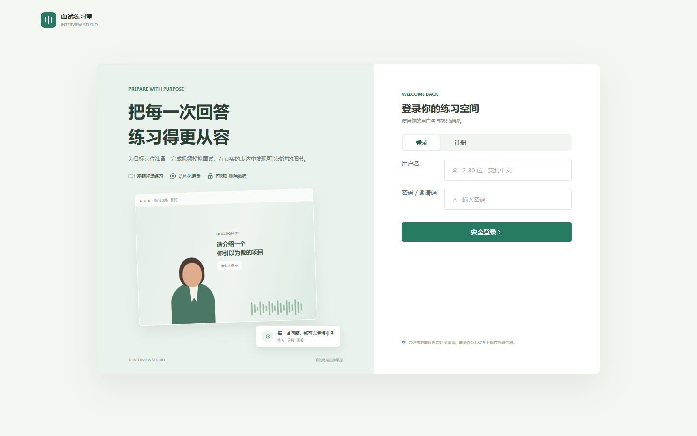
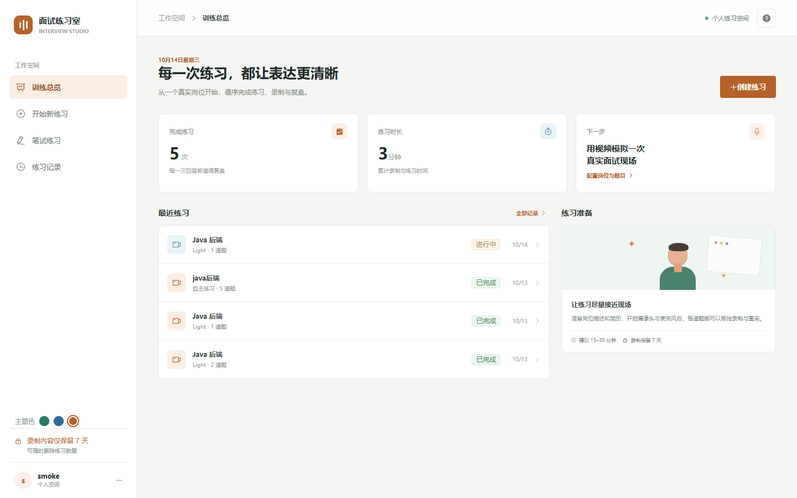
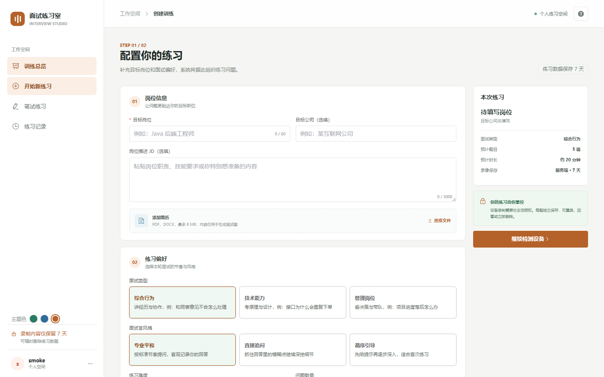
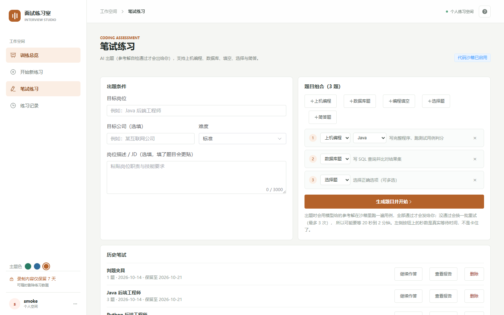
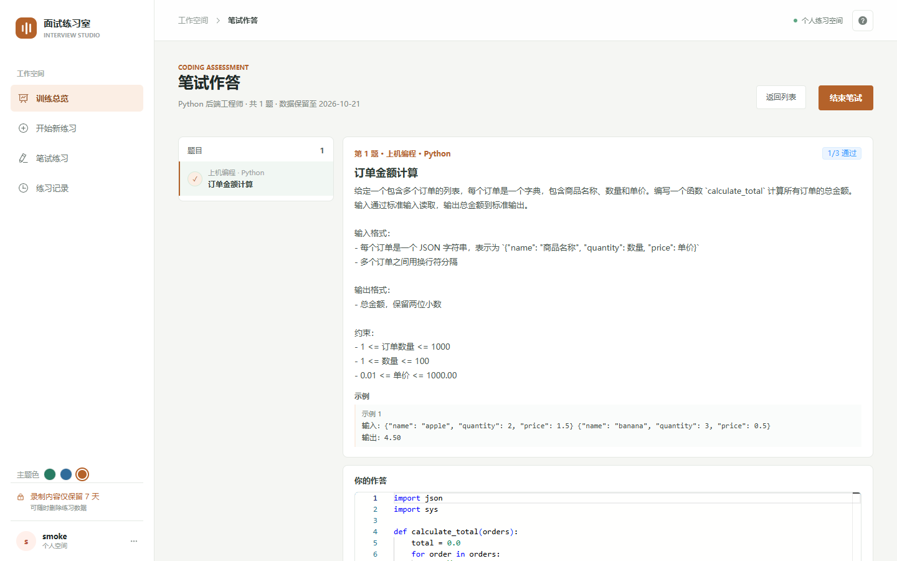
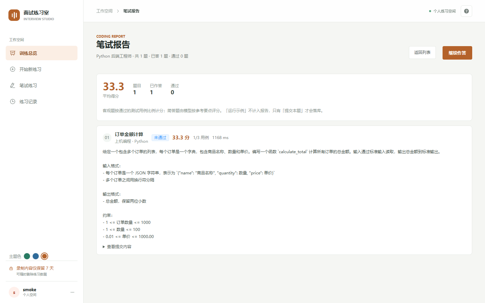

# 🎯 Light-Interview — an open-source AI interview trainer

**Video interviews and a real coding assessment, end to end: AI writes the questions → you record your answers in the browser → speech is transcribed → the model scores it against a fixed schema → you get a replayable report.**
And it **actually runs the code you write** — if your program fails the test cases, it fails.

[中文 README](../README.md) · [User guide](USER-GUIDE.md) · [Architecture](ARCHITECTURE.md) · [Deployment](DEPLOYMENT.md) · [Status](STATUS.md)

[](https://opensource.org/licenses/Apache-2.0)
[](https://adoptium.net/)
[](https://spring.io/projects/spring-boot)
[](https://spring.io/projects/spring-ai)
[](https://vuejs.org/)
[](https://makeapullrequest.com)

## 📸 What it looks like

| Login and registration | Dashboard |
| --- | --- |
|  |  |

| Practice setup (AI question planning) | Coding assessment setup |
| --- | --- |
|  |  |

| Coding assessment (web IDE) | Coding report (scored by test cases) |
| --- | --- |
|  |  |

> The screenshots are captured by `web/scripts/capture-screenshots.mjs`, which drives a real browser
> against a locally running stack, so they can be regenerated after any UI change instead of drifting
> away from the code.

## 😰 Sound familiar?

- You solved hundreds of problems, but "tell me about a project you led" still stalls you
- You want to practise, but nobody sets the questions and nobody gives feedback
- The AI interview tools you tried only chat — they **will not run your code**, so a wrong answer looks fine

## ✨ What this project does differently

| | |
| --- | --- |
| 🎥 **Recorded, and genuinely scored** | Record each answer in the browser → Paraformer transcription → an LLM scores it against a **fixed JSON schema** (relevance, completeness, professionalism, STAR, logic, plus speech rate, pauses and filler words). Every claim in the report **links back to the exact moment in the video** |
| 💻 **A coding test that cannot cheat** | Java / Python / C++ / JavaScript / Go are compiled and executed inside a **throwaway Docker sandbox**: no network, capped memory, capped CPU, hard timeouts, read-only filesystem. Fail the cases and you fail the question |
| 🧠 **Questions are self-checked** | Every generated question is first run against its **own reference solution** in the sandbox; only questions whose reference passes every case are handed to you. You will never get a question whose model answer does not even compile |
| 🧩 **Five question types** | Hands-on coding, database questions (executed against a temporary SQLite), fill-in-the-blank, multiple choice, short answer |
| 🎨 **Pick your palette** | Three themes — pine green, navy, ochre — saved per account |
| 📊 **Operable, not just runnable** | Prometheus metrics, exponential back-off retries and a dead-letter queue for the analysis pipeline; resumable chunked uploads for recordings |

> **No API key required to try it.** Two local stub providers let the whole pipeline run end to end
> (with placeholder transcription and scoring); swap in a real key when you have one.

## 🚀 Core features

| Area | What it does |
| --- | --- |
| Practice setup | Target role, company, job description, résumé, interview type / interviewer style / difficulty / question count and duration |
| Device check | Camera and microphone permission with live preview; you cannot enter the interview until the volume check passes |
| AI question planning | Parses an uploaded PDF / Word résumé together with the role and JD; falls back to a built-in catalogue when the model is unavailable. Résumé text is used for planning only and is never stored |
| Mock interview | An animated interviewer reads the question aloud (with a text-only fallback), one recording per question, pausable and re-recordable |
| AI review | Transcription → structured scoring → a per-question report with clickable video evidence |
| Coding assessment | Write code in a Monaco web IDE; "Run samples" is free and unstored, "Submit" runs every case including hidden ones and scores by pass rate |
| Retention | Recordings and coding sessions are kept for 7 days by default and can be deleted at any time, removing media, transcription and scores together |

## 🎬 Demo

The repository ships the iteration recordings, so you can see it in action:

| Iteration | Content |
| --- | --- |
| [step1.mp4](../docs/step1.mp4) | Project setup: login, practice configuration, question generation |
| [step2.mp4](../docs/step2.mp4) | Mock interview: the interviewer reading questions, recording per answer |
| [step3.mp4](../docs/step3.mp4) | The review report and its timeline evidence |
| [step4.mp4](../docs/step4.mp4) | Full walkthrough |

## 🛠 Tech stack

| Layer | Choice |
| --- | --- |
| Backend | Java 21 · Spring Boot 3.4 · Spring AI 1.1.8 · Spring AI Alibaba 1.1.2.4 (DashScope) |
| Frontend | Vue 3.5 · Vite 6 · Element Plus · Pinia · Monaco Editor |
| Storage | PostgreSQL 16 + pgvector · Redis 7 · S3-compatible object storage (local disk / MinIO / AWS S3) |
| Media | Browser `MediaRecorder` · ffmpeg audio extraction · Paraformer ASR · Sambert TTS |
| Code execution | Per-run Docker containers (Temurin 21, python:3.12-slim, gcc:13, node:20-alpine, golang:1.22-alpine) |

## ⚡ Quick start

```bash
# 1. Configuration
cp .env.example .env          # fill in Ali_API_KEY and AUTH_TOKEN_SECRET

# 2. Infrastructure: Postgres + Redis + S3-compatible storage
docker compose up -d

# 3. Build and start the backend (Flyway migrations run on first start)
mvn -B clean package
java -jar consumer/target/consumer-0.0.1-SNAPSHOT.jar

# 4. Frontend
cd web && npm install && npm run dev
```

Open <http://localhost:5173>, click **注册 (Register)** on the login page and create an account —
the demo account is `smoke / 123456`. The backend reads `.env` from the repository root automatically.

To enable the coding sandbox, set `CODE_RUNNER_ENABLED=true` (it executes arbitrary user code on your
machine, so it is off by default). See [DEPLOYMENT.md](DEPLOYMENT.md) for the full variable reference.

## 🧪 Tests

```bash
mvn -B clean package                                       # unit tests, container tests skipped
mvn -B test -Ddb.integration=true -Ds3.integration=true     # against real Postgres and S3
mvn -B -pl consumer test -Dtest=CodeRunnerServiceTest -Dcode.runner.integration=true   # docker sandbox
npm --prefix web test                                       # frontend unit tests
pwsh scripts/smoke-test.ps1 -Name smoke -Code 123456 -ExpectAnalysisReady               # end-to-end
pwsh scripts/e2e-real-providers.ps1                         # real model chain, writes an audit artifact
```

## 📁 Layout

```
consumer/    Spring Boot app (practice / analysis / avatar / coding + code sandbox / storage / security, Flyway migrations)
common/      Shared utilities: unified responses, exceptions, JWT, CORS
web/         Vue 3 single-page app
scripts/     End-to-end and smoke test scripts
docs/        Deployment notes and these guides
```

## 🔌 API

```text
POST   /login                                                       Login
POST   /register                                                    Self-service registration
POST   /api/v1/practice-sessions                                    Create a practice session
POST   /api/v1/practice-sessions/question-plan                      Generate questions for a role and JD
POST   /api/v1/resume/extract                                       Extract résumé text (PDF / Word)
POST   /api/v1/practice-sessions/{id}/answers                       Save one answer
POST   /api/v1/answers/{id}/media                                   Upload the recording (multipart)
POST   /api/v1/practice-sessions/{id}/complete                      Finish and enqueue analysis
GET    /api/v1/practice-sessions/{id}/report                        Per-question report
GET    /api/v1/media/{id}/signed-url                                Issue a time-limited playback URL
GET    /api/v1/analysis/dlq                                         Dead-letter queue (per account)
POST   /api/v1/analysis/dlq/{jobId}/requeue                         Requeue a dead-lettered job

# Coding assessment (AI question generation + Docker sandbox judging)
GET    /api/v1/coding-sessions/capabilities                         Sandbox status, languages, question types
POST   /api/v1/coding-sessions                                      Generate questions (self-checked, takes a while)
GET    /api/v1/coding-sessions/{id}                                 Questions (never answers) and submission summary
POST   /api/v1/coding-sessions/{id}/questions/{q}/run               Run visible samples only, not stored
POST   /api/v1/coding-sessions/{id}/questions/{q}/submit            Run every case including hidden ones, scored
GET    /api/v1/coding-sessions/{id}/report                          Coding report
```

## ✅ Verification status

We would rather tell you what is not proven yet than pretend everything is done.

Verified: clean builds, 126 backend tests (plus 7 sandbox tests that need Docker), 38 frontend tests, a
24-assertion end-to-end smoke script, the real model chain (question planning, Paraformer transcription,
Sambert synthesis, Spring AI evaluation) against a live key, and the code sandbox — including a killed
infinite loop and blocked network access inside the container.

Not yet verified: a single session that combines a real camera recording with real model scoring
(both halves are verified separately), and the two camera acceptance cases (permission denied, recording
interrupted). The amplitude-driven mouth animation is build-verified only. Details and evidence live in
[STATUS.md](STATUS.md).

## 🤝 Contributing

Issues and pull requests are welcome — new question types, new language sandboxes and better prompts
all count. If the project helps you, a **star** is the most direct way to support it and to help other
people preparing for interviews find it.

## 📄 License

Apache License 2.0. Rebuilt from [guangge](https://github.com/xgwangdl)'s AI-Interview.

> Interviews are trained, not memorised. Good luck with your offer 🎉
